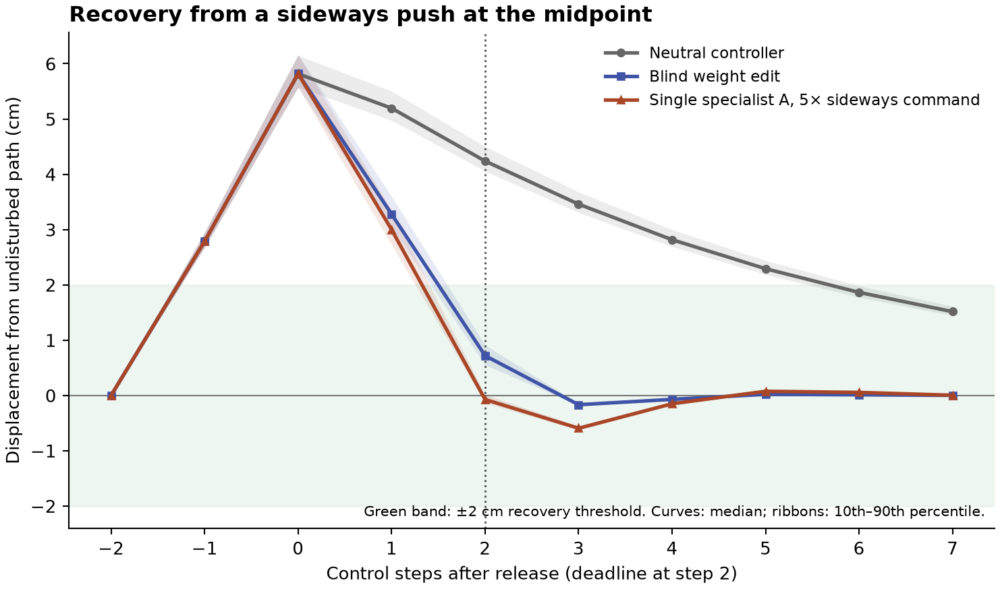

# Can weight-space programming bridge the gap between two RL specialists?

Suppose two reinforcement-learning policies each perform well in the conditions they trained on, yet both fail somewhere in between. My hypothesis is that **the two specialists may already encode a shared rule that would help in the gap. A writer model could locate that rule in their weights, amplify it, and build a policy that generalizes to the missing condition without running another round of reinforcement learning there.**

I think of the specialists as two **performance peaks**. The bridge I want is behavioral: one policy keeps the endpoint skills and succeeds where both specialists struggled. Establishing that the training objective has two distinct local maxima, or finding a continuous path of high reward through parameter space, would require a separate measurement.

I tested the idea in two stages with a simulated robot arm. The first asked whether a writer could bridge a gap between target locations. The second asked the harder question: *did the writer find something shared in the original policies, and did amplifying it cause better generalization?* Both stages used existing endpoint examples. The writers could fit weights offline; the hidden conditions supplied neither rewards nor practice episodes for the edit.
The repository includes the reaching pilot’s score table and a runnable replay of the sideways-push experiment

## First, establish a gap worth bridging

In the reaching pilot, one specialist had trained on targets to the left and the other on targets to the right. On a fresh evaluation, each reached **128/128** targets at its own endpoint and **0/128** at the midpoint. The blind writer’s combined policy reached **128/128** at all three positions. But another controller learned from the endpoint demonstrations alone and matched that score. The bridge was real. Success by itself could not tell us whether the writer had discovered a shared concept inside the two networks. [Reaching-pilot scores](expected/earlier-reaching-pilot.csv)

To test the mechanism, I needed a shared rule I could perturb. Push a robot arm sideways and both controllers try to steer it back. If the writer has found the computation behind that correction, it should be able to turn the response down, turn it up, and predict what the arm will do before running the simulator.

I put that test to **Astra 6.2 with high reasoning** in a separate chat. In a new pair of policies, it identified a sideways correction in both and built a controller with an adjustable response. On stronger midpoint pushes, the neutral controller recovered in time on **0/64** trials. With the response turned up, it recovered on **64/64**.

## What the writer could see

The robot was a simulated Fetch arm reaching for a target. Two policies had been trained from the same random initialization on different target locations. Each had 1,379 parameters, six input channels and three motor commands. The blind writer received the weights, the forward-pass code, matched examples of ordinary reaches and pushes in both directions, and sample inputs labeled with both policies’ actions. It could inspect those numbers and fit an edit. A separate evaluator held the simulator and test cases. I posed the hypothesis and handed off the blind packet. An AI assistant helped design and run the simulation and analyze the submission.

A push briefly overrode a motor command. For each trial, the evaluator also ran an undisturbed twin with the same target and starting pose. We counted a rapid recovery if the pushed arm came back within **2 cm** of its twin’s lateral position **two control steps after release**. The middle condition deliberately applied a stronger push. Both original policies could still reach the final goal. What they struggled with was getting back on track quickly.

## The prediction came first

The writer used the paired trajectories to infer which combinations of the six anonymous inputs represented sideways displacement and motion. It predicted that both networks used the first motor channel to push back in the opposite direction. When decoded against the evaluator’s hidden coordinate map, each inferred direction aligned with the corresponding physical axis to better than 0.999 in absolute cosine similarity.

The writer made two independently testable commitments. In the **original policies**, it nominated 16 output weights that it believed carried much of the correction. In a **combined controller** fitted using the supplied actions, it concentrated the position response into one hidden feature and supplied a 34-parameter adjustment. The evaluator could subtract the adjustment, leave it at zero, or add it. The 34 weights count the change from the fitted neutral controller. Constructing that controller involved additional fitting. [Original instructions](writer/START_HERE.txt) · [Writer’s frozen prediction](prediction.txt)

At the midpoint, weakening the response increased mean error to **5.09 cm**. The neutral setting left **4.26 cm**. Amplification brought it down to **0.73 cm**. The amplified arm briefly overshot, as predicted, though it crossed the undisturbed path later than the writer expected on the midpoint trials.

The test in the original policies mattered just as much. Returning the 16 nominated weights to their initialization cut rapid recovery at the respective training endpoints from **64/64 to 6/64** in one policy and **64/64 to 18/64** in the other. All five same-size random resets in each policy caused less damage. [Frozen protocol](staff/protocol.txt) · [Scored interventions and controls](expected/frozen-scores.csv)

## What one line could do

After scoring the submission, I tried a control suggested by its own measurements. The writer’s amplified command on the endpoint examples was about five times as large as its neutral correction. What if we just multiplied the sideways output by five and clipped it to the permitted range?

```python
action[0] = np.clip(5.0 * action[0], -1.0, 1.0)
```

| Controller | Rapid recoveries at midpoint | Mean error two steps after release | Mean maximum overshoot |
|---|---:|---:|---:|
| Writer’s neutral controller | 0/64 | 4.26 cm | 0.00 cm |
| Writer’s amplified controller | 64/64 | 0.73 cm | 0.17 cm |
| Original policy A with 5× lateral output | 64/64 | 0.08 cm | 0.59 cm |
| Original policy B with 5× lateral output | 64/64 | 0.14 cm | 0.68 cm |



Both approaches recovered on all **320 pushes across five test positions**. The output adjustment came closer at the deadline and overshot farther afterward. It used the action channel and approximate gain already identified by the writer. This was a retrospective comparison on the same trials. [Control implementation](output_gain.py) · [Full control results](expected/output-gain.csv)

## How far does this support the hypothesis?

The two experiments answer different parts of the question. In the reaching pilot, the specialists had complementary endpoint skills and a real performance valley between them. In the push test, both policies already handled weak pushes at both endpoints. The midpoint was harder because the evaluator applied a stronger disturbance there. That design let us isolate one proposed shared concept: **sense sideways displacement and push back against it**.

The source-weight resets showed that the writer had located part of that response in each specialist. Turning up its reconstructed response then closed the rapid-recovery gap without fresh RL on middle conditions. A simple output adjustment achieved the same recovery count. The evidence supports a possible route to generalization while leaving open how often two sets of weights help a writer discover a rule it could not infer from behavior alone.

The next test is to bring both properties together in the same pair: genuinely complementary specialists, and a shared correction whose strength must depend on context. If amplification helps in one condition but causes costly overshoot in another, the writer must discover *when* to use the rule. A blind comparison with a writer given the same endpoint behavior and no trained weights would tell us what access to the weights contributes.

## Reproduce the study

The package includes the blind writer’s inputs, its submitted weights, the private scoring protocol used for this run, the output-gain control, and machine-readable results. With Python 3.12, the CPU replay checks **47 intervention and control rows plus 10 output-gain rows**. The writer’s original fitting script is unavailable here, so the replay starts from its frozen submission. [Replay instructions](REPRODUCE.md)

This independent, AI-assisted experiment builds on prior work in weight-space programming. Takehi and colleagues showed that a language model could repair a failing Kinetix controller by editing its weights. Lehmann’s work on unseen games compared policies written in weight space with ordinary programs. Both informed the question asked here. [Sparks of Weight-Space Programming](https://rikiyat.github.io/blog/weight-space-programming/) · [Compiling Known Rules into Compact Neural Agents](https://arxiv.org/abs/2611.16981)
